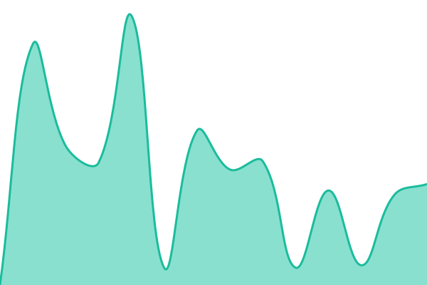

# [📈 Live Status](https://digiclubir-lab.github.io/nabz-uptime-Public): <!--live status--> **🟩 All systems operational**

This repository contains the open-source uptime monitor and status page for [digiclubir-lab](https://digiclubir-lab.github.io/nabz-uptime-Public), powered by [Upptime](https://github.com/upptime/upptime).

With [Upptime](https://upptime.js.org), you can get your own unlimited and free uptime monitor and status page, powered entirely by a GitHub repository. We use [Issues](https://github.com/digiclubir-lab/nabz-uptime-Public/issues) as incident reports, [Actions](https://github.com/digiclubir-lab/nabz-uptime-Public/actions) as uptime monitors, and [Pages](https://digiclubir-lab.github.io/nabz-uptime-Public) for the status page.

<!--start: status pages-->
<!-- This summary is generated by Upptime (https://github.com/upptime/upptime) -->
<!-- Do not edit this manually, your changes will be overwritten -->
<!-- prettier-ignore -->
| URL | Status | History | Response Time | Uptime |
| --- | ------ | ------- | ------------- | ------ |
|  [Nabz website](https://nabzfx.com/) | 🟩 Up | [nabz-website.yml](https://github.com/digiclubir-lab/nabz-uptime-Public/commits/HEAD/history/nabz-website.yml) | 

 2504ms
     
 | 

<a href="https://digiclubir-lab.github.io/nabz-uptime-Public/history/nabz-website">100.00%</a>
    

|  [Nabz API](https://nabzfx.com/wp-json/) | 🟩 Up | [nabz-api.yml](https://github.com/digiclubir-lab/nabz-uptime-Public/commits/HEAD/history/nabz-api.yml) | 

 6209ms
     
 | 

<a href="https://digiclubir-lab.github.io/nabz-uptime-Public/history/nabz-api">100.00%</a>
    

|  [Nabz panel](https://nabzfx.com/nabz-panel/) | 🟩 Up | [nabz-panel.yml](https://github.com/digiclubir-lab/nabz-uptime-Public/commits/HEAD/history/nabz-panel.yml) | 

 5672ms
     
 | 

<a href="https://digiclubir-lab.github.io/nabz-uptime-Public/history/nabz-panel">100.00%</a>
    

<!--end: status pages-->

[**Visit our status website →**](https://digiclubir-lab.github.io/nabz-uptime-Public)

## 📄 License

- Powered by: [Upptime](https://github.com/upptime/upptime)
- Code: [MIT](./LICENSE) © [Anand Chowdhary](https://anandchowdhary.com)
- Data in the `./history` directory: [Open Database License](https://opendatacommons.org/licenses/odbl/1-0/)
